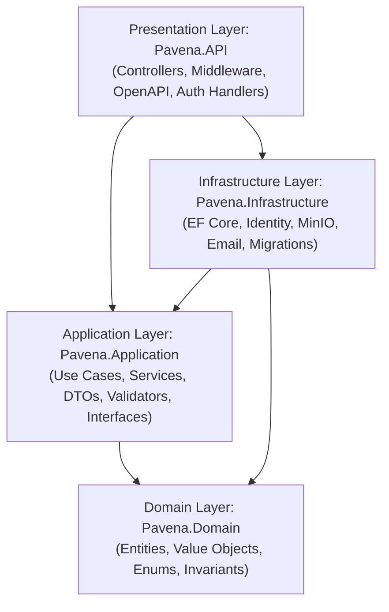

# Pavena — Module Boundaries & Layer Dependencies

**Document Version:** 1.0  
**Phase:** Phase 1 Foundation Engineering  

---

## 1. Clean Architecture Layers

### Layer Responsibilities

1. **`Pavena.Domain` (Core Business Rules):**
   - Contains pure C# domain entities, value objects, enumeration types, and domain invariants.
   - Zero dependencies on any external framework, ORM, or web package.
   - Enforces business rules at instantiation and state transition.

2. **`Pavena.Application` (Use Case Orchestration):**
   - Coordinates application workflows via domain services and interfaces.
   - Defines ports (interfaces) for persistence (`IPavenaDbContext`), storage (`IObjectStorageService`), email (`IEmailService`), and current user resolution (`ICurrentUserService`).
   - Contains Data Transfer Objects (DTOs), mapping logic, and input validation.

3. **`Pavena.Infrastructure` (Technology Adapters):**
   - Implements ASP.NET Core Identity with EF Core stores (`IdentityDbContext`).
   - Houses `PavenaDbContext`, `IEntityTypeConfiguration<T>` mappings, and migration snapshots.
   - Adapts cloud services (MinIO S3 storage, SMTP/SendGrid email).

4. **`Pavena.API` (Presentation & Composition Root):**
   - Exposes RESTful HTTP endpoints conforming to `/api/v1/*`.
   - Handles authentication cookies, JWT tokens, CORS, and rate limiting.
   - Enforces authorization policies (`IAuthorizationRequirement` and `AuthorizationHandler<T>`).
   - Converts domain exceptions to RFC 7807 `ProblemDetails` via centralized middleware.

---

## 2. Bounded Contexts

| Bounded Context | Core Domain Responsibility | Foundation Status in Phase 1 |
|---|---|---|
| **Identity & Access** | User credentials, password hashing, verification, platform roles (`Superadmin`, `PlatformAdmin`), audit logs. | **Full Implementation** |
| **User Profiles** | Individual profile, education, experience, skills, research interests, account status. | **Full Implementation** |
| **Organizations** | University, school, company, research institute entities, departments, and memberships. | **Full Implementation** |
| **Social Graph** | Mutual connections, one-way follows, user blocks. | **Domain & Database Foundation** |
| **Research Workspaces** | Research projects, project memberships, invitations, tasks, milestones. | **Domain & Database Foundation** |
| **Documents & Collaboration**| WYSIWYG & LaTeX documents, collaborator ACL, CRDT snapshot metadata. | **Domain & Database Foundation** |
| **Industry Challenges (Hilir)**| Sponsored challenges, FSM lifecycle, two-tier NDA gating, eligibility verification. | **Full Implementation (Milestone O)** |
