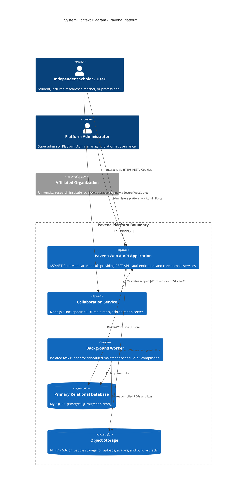

# Pavena — System Context & High-Level Architecture

**Document Version:** 1.0  
**Phase:** Phase 1 Foundation Engineering  

---

## 1. System Overview

Pavena is an individual-first Academic Collaboration Platform providing social networking, research workspaces, collaborative scientific writing, and publication discovery.

---

## 2. Key Architecture Decisions

1. **Modular Monolith over Microservices:** The entire core application resides in a single deployable ASP.NET Core process with strongly separated logical module boundaries.
2. **Direct Application Services over CQRS/MediatR:** Following explicit architectural instructions, domain orchestration uses standard C# interfaces and application services (`IAuthenticationService`, `IOrganizationService`) without mediator indirection or event sourcing.
3. **Decoupled Real-Time Architecture:** Real-time CRDT editing is offloaded to a dedicated Node.js Hocuspocus service, preventing memory-intensive CRDT states from taxing the main web process.
4. **Sandboxed LaTeX Worker:** LaTeX compilation runs in an isolated container environment with resource limits and zero outbound network access.
