# Pavena — Domain Model Specification

**Document Version:** 1.0  
**Phase:** Phase 1 Foundation Engineering  

---

## 1. Domain Overview

Pavena's domain model reflects an individual-first academic collaboration platform. The domain is partitioned into six cohesive sub-domains:

```mermaid
classDiagram
    direction TB
    
    namespace Identity_and_Profiles {
        class User
        class UserProfile
        class UserEducation
        class UserExperience
        class UserSkill
        class UserInterest
    }

    namespace Platform_Governance {
        class PlatformRole
        class UserPlatformRole
        class AdminAuditLog
        class ModerationReport
    }

    namespace Organizations {
        class Organization
        class OrganizationMembership
        class OrganizationDepartment
        class OrganizationVerification
    }

    namespace Social_Graph {
        class Connection
        class Follow
        class UserBlock
    }

    namespace Research_Workspaces {
        class ResearchProject
        class ResearchMember
        class ResearchInvitation
        class ResearchTask
    }

    namespace Documents {
        class Document
        class DocumentCollaborator
        class DocumentSnapshot
        class LatexSourceFile
    }

    User "1" *-- "1" UserProfile
    User "1" *-- "0..*" UserEducation
    User "1" *-- "0..*" UserExperience
    User "1" *-- "0..*" UserSkill
    User "1" *-- "0..*" UserInterest
    User "1" -- "0..*" UserPlatformRole
    User "1" -- "0..*" OrganizationMembership
    Organization "1" *-- "0..*" OrganizationMembership
    User "1" -- "0..*" Connection
    User "1" -- "0..*" Follow
    User "0..1" -- "0..*" ResearchProject : owns
    Organization "0..1" -- "0..*" ResearchProject : owns
    ResearchProject "1" *-- "0..*" ResearchMember
    ResearchProject "1" *-- "0..*" ResearchTask
    User "1" -- "0..*" Document : owns
    Document "1" *-- "0..*" DocumentCollaborator
    Document "1" *-- "0..*" DocumentSnapshot
```

---

## 2. Core Domain Design Principles

1. **Individual Primacy:** Every physical user has exactly one `User` entity and one primary `UserProfile`. Institutional affiliation (`OrganizationMembership`) is strictly optional.
2. **Contextual Role Isolation:** Global administrative roles (`Superadmin`, `PlatformAdmin`) are stored separately from organizational membership classifications (`Student`, `Lecturer`, `Researcher`, `Employee`, `OrganizationAdmin`) and resource roles (`Owner`, `ProjectManager`, `DocumentCollaborator`).
3. **Mutual Connection Model:** User connections require mutual consent. Canonical pairing (`min(RequesterId, AddresseeId)` and `max(RequesterId, AddresseeId)`) guarantees that no duplicate relationship can exist regardless of request direction.
4. **Mutually Exclusive Project Ownership:** A `ResearchProject` has exactly one owner: either a `User` OR an `Organization`.
5. **Independent Document Access:** A `Document` belongs to a single owner. Associating a document with a research project does not bypass document-level collaborator authorization.
