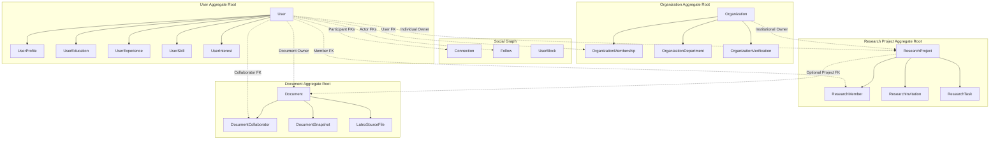

# Pavena — Domain Relationships & Aggregate Boundaries

**Document Version:** 1.0  
**Phase:** Phase 1 Foundation Engineering  

---

## 1. Aggregate Root Boundaries

---

## 2. Cardinality & Navigation Rules

| Source Entity | Target Entity | Cardinality | EF Core Navigation Rule | Notes |
|---|---|:---:|---|---|
| `User` | `UserProfile` | 1 : 1 | Required parent-child navigation. | Shared PK (`UserId`). |
| `User` | `UserEducation` | 1 : 0..* | Collection on `User`. | Cascade delete. |
| `User` | `UserExperience` | 1 : 0..* | Collection on `User`. | Cascade delete. |
| `User` | `OrganizationMembership` | 1 : 0..* | Direct FK `UserId`. | Restricted or cascade delete depending on audit policy. |
| `Organization` | `OrganizationMembership` | 1 : 0..* | Direct FK `OrganizationId`. | Cascade delete memberships on org removal. |
| `User` | `ResearchProject` | 1 : 0..* | Nullable FK `OwnerUserId`. | Restrict delete if active projects exist. |
| `Organization` | `ResearchProject` | 1 : 0..* | Nullable FK `OwnerOrganizationId`. | Restrict delete if active projects exist. |
| `ResearchProject`| `Document` | 1 : 0..* | Nullable FK `ProjectId` on Document. | Set null on project deletion. |
| `User` | `Document` | 1 : 0..* | Direct FK `OwnerUserId` on Document. | Restrict delete if active documents exist. |
| `Document` | `DocumentCollaborator` | 1 : 0..* | Direct FK `DocumentId`. | Cascade delete on document removal. |
