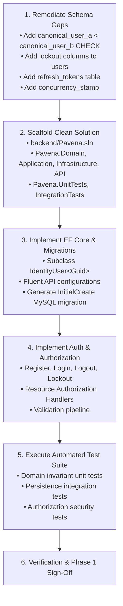

# Pavena — Phase 1 Independent Technical & Security Audit Report

**Audit Date:** 2026-11-03  
**Auditor:** Independent Principal Software Architect & Application Security Reviewer  
**Scope:** Phase 1 Foundation Engineering (Architecture, Domain Model, Persistence, Identity, RBAC, Security, and Tests)  
**Reference Baseline:** `AGENTS.md`, `.agent/skills/*`, Approved ADRs, and Architecture Documentation  

---

## Executive Summary

An independent architectural and security audit of Pavena Phase 1 was conducted. The audit evaluated the codebase, schema specifications, architecture decision records, domain invariants, and security controls across 12 critical areas.

While the conceptual architecture, domain models, data dictionary, and multi-layer RBAC matrices in `docs/` demonstrate strong architectural alignment with Pavena principles, **the physical implementation of the C# solution, EF Core migrations, and automated test suites has not yet been executed in the repository**. Additionally, several critical and high-severity design discrepancies were discovered in the database schema, Identity integration, and constraint modeling.

### Readiness Verdict: **NOT READY**

> [!CAUTION]
> The project cannot proceed to Phase 2 (Social Networking & Feeds) until the C# foundation solution is scaffolded, all CRITICAL and HIGH findings are remediated, EF Core migrations are generated and tested against MySQL, and the automated test suite passes with 100% compliance.

---

## Summary of Findings by Severity

| Severity | Count | Primary Areas Affected |
|---|:---:|---|
| **CRITICAL** | 2 | Missing source code/EF Core implementation, zero automated test coverage. |
| **HIGH** | 5 | Missing account lockout fields, connection canonical order constraint gap, missing refresh token storage, missing resource authorization handlers, missing DTO validation pipeline. |
| **MEDIUM** | 4 | Concurrency tokens missing, project owner foreign key cascade conflict, dual role table ambiguity, PostgreSQL `CHAR(36)` performance trade-off. |
| **LOW** | 1 | Solution naming documentation inconsistency. |
| **INFORMATIONAL** | 1 | Container orchestration configuration recommendation. |

---

## Detailed Audit Findings

### 1. Domain Integrity & Entity Relationships

#### Finding 1.1 — Missing Check Constraint on Connections Canonical Ordering
- **Classification:** **HIGH**
- **Location:** [`docs/database/mysql-schema.md`](file:///D:/coding/_toscaflow_/pavena/docs/database/mysql-schema.md#L98-L112) & [`docs/domain/domain-invariants.md`](file:///D:/coding/_toscaflow_/pavena/docs/domain/domain-invariants.md#L20-L28).
- **Technical Explanation:** The `connections` table enforces unique pairs via `CONSTRAINT uq_connections_canonical_pair UNIQUE (canonical_user_a, canonical_user_b)` and prevents self-connections via `CHECK (requester_user_id <> addressee_user_id)`. However, there is no database-level constraint enforcing that `canonical_user_a < canonical_user_b`. If an application bug or direct insertion fails to sort the user GUIDs, two reverse records (e.g. `(U1, U2)` and `(U2, U1)`) can be persisted simultaneously, breaking connection uniqueness.
- **Potential Impact:** Duplicate mutual connections created under race conditions or application bugs.
- **Recommended Remediation:** Add a database check constraint:
  ```sql
  CONSTRAINT chk_conn_canonical_order CHECK (canonical_user_a < canonical_user_b)
  ```
- **Relevant Test Case:** Attempt to insert a connection entity with `canonical_user_a >= canonical_user_b` directly in EF Core persistence tests; assert database exception.

---

#### Finding 1.2 — Foreign Key Cascade Conflict on Personal Research Project Deletion
- **Classification:** **MEDIUM**
- **Location:** [`docs/database/mysql-schema.md`](file:///D:/coding/_toscaflow_/pavena/docs/database/mysql-schema.md#L152-L157).
- **Technical Explanation:** In `research_projects`, `owner_user_id` has `ON DELETE SET NULL`. However, `chk_rp_single_owner` mandates:
  ```sql
  CHECK ((owner_user_id IS NOT NULL AND owner_organization_id IS NULL) OR
         (owner_user_id IS NULL AND owner_organization_id IS NOT NULL))
  ```
  If a user who owns an individual project is deleted, MySQL sets `owner_user_id = NULL`. Because `owner_organization_id` is also `NULL`, this immediately triggers a `CHECK` constraint violation, causing user deletion to crash.
- **Potential Impact:** User deletion or GDPR account purge fails catastrophically for project owners.
- **Recommended Remediation:** Change `fk_rp_owner_user` to `ON DELETE RESTRICT`. Enforce that users must transfer ownership or archive projects prior to account deletion.
- **Relevant Test Case:** Integration test attempting to delete a user who owns an active personal project; verify expected rejection.

---

### 2. Database Normalization & Constraints

#### Finding 2.1 — Omission of Sub-Entity DDL in Physical MySQL Schema
- **Classification:** **HIGH**
- **Location:** [`docs/database/mysql-schema.md`](file:///D:/coding/_toscaflow_/pavena/docs/database/mysql-schema.md) vs [`docs/domain/entity-catalog.md`](file:///D:/coding/_toscaflow_/pavena/docs/domain/entity-catalog.md#L35-L55).
- **Technical Explanation:** The domain catalog and data dictionary define `user_educations`, `user_experiences`, `user_skills`, `user_interests`, `organization_departments`, and `research_tasks`. However, `mysql-schema.md` omits their corresponding DDL definitions.
- **Potential Impact:** Database schema specification is incomplete and desynchronized from the domain model.
- **Recommended Remediation:** Provide the complete physical DDL for all cataloged foundation entities in `mysql-schema.md` and EF Core configurations.
- **Relevant Test Case:** DbContext model verification test asserting all entities map to valid tables.

---

#### Finding 2.2 — Missing Concurrency Protection on Editable Aggregate Roots
- **Classification:** **MEDIUM**
- **Location:** [`docs/database/mysql-schema.md`](file:///D:/coding/_toscaflow_/pavena/docs/database/mysql-schema.md) (`user_profiles`, `research_projects`, `documents`).
- **Technical Explanation:** No concurrency token (`concurrency_stamp` or row version) exists on mutable core entities.
- **Potential Impact:** Concurrent updates (e.g., two collaborators modifying document metadata or project settings) will silently overwrite each other (lost update anomaly).
- **Recommended Remediation:** Add `concurrency_stamp CHAR(36) NOT NULL` to all mutable aggregate roots and configure `.IsConcurrencyToken()` in EF Core.
- **Relevant Test Case:** Attempt concurrent updates on the same entity revision; verify `DbUpdateConcurrencyException`.

---

### 3. MySQL Migration Correctness

#### Finding 3.1 — Absence of Compiled EF Core Migrations
- **Classification:** **CRITICAL**
- **Location:** File system (`backend/src/Pavena.Infrastructure/Migrations/` is missing).
- **Technical Explanation:** While DDL documentation was written, no EF Core `DbContext` or compiled migration snapshots exist in the repository.
- **Potential Impact:** Persistence cannot be initialized, version-controlled, or executed in CI/CD.
- **Recommended Remediation:** Scaffold the backend solution, configure `PavenaDbContext`, and generate the `InitialCreate` migration using the .NET CLI.
- **Relevant Test Case:** `dotnet ef database update` executes cleanly against MySQL 8.0.

---

### 4. PostgreSQL Portability Risks

#### Finding 4.1 — `CHAR(36)` String UUID Storage vs Native PostgreSQL `uuid`
- **Classification:** **MEDIUM**
- **Location:** [`docs/architecture/decisions/ADR-0005-uuid-identifier-strategy.md`](file:///D:/coding/_toscaflow_/pavena/docs/architecture/decisions/ADR-0005-uuid-identifier-strategy.md) & [`docs/database/postgresql-migration-strategy.md`](file:///D:/coding/_toscaflow_/pavena/docs/database/postgresql-migration-strategy.md).
- **Technical Explanation:** Mandating `CHAR(36)` across all databases avoids byte-endianness bugs in MySQL, but forces PostgreSQL to store 36 bytes per UUID instead of its optimized 16-byte native `uuid` type, inflating btree index size and slowing joins.
- **Potential Impact:** Suboptimal PostgreSQL query performance and storage inefficiency after migration.
- **Recommended Remediation:** Let EF Core manage the mapping portably: map `Guid` properties using EF Core's default mapping, which natively emits `CHAR(36)` on Pomelo MySQL and native `uuid` on Npgsql PostgreSQL without manual type coercion.
- **Relevant Test Case:** Generate migrations for both providers and verify native type resolution.

---

### 5. ASP.NET Core Identity Implementation

#### Finding 5.1 — Absence of Identity Source Code & Stores
- **Classification:** **CRITICAL**
- **Location:** File system (`backend/src/` missing).
- **Technical Explanation:** The ASP.NET Core Identity setup (`User : IdentityUser<Guid>`, `UserManager`, `SignInManager`) has not been coded or wired into dependency injection.
- **Potential Impact:** Core authentication functionality is currently theoretical and non-operational.
- **Recommended Remediation:** Implement `User` extending `IdentityUser<Guid>`, configure `AddIdentity<User, PlatformRole>()` in `Pavena.Infrastructure`, and bind to `PavenaDbContext`.
- **Relevant Test Case:** Integration test registering and authenticating a user via `UserManager`.

---

#### Finding 5.2 — Missing Account Lockout Columns in Schema
- **Classification:** **HIGH**
- **Location:** [`docs/database/mysql-schema.md`](file:///D:/coding/_toscaflow_/pavena/docs/database/mysql-schema.md#L12-L28).
- **Technical Explanation:** The documented `users` table lacks `lockout_end`, `lockout_enabled`, and `access_failed_count`.
- **Potential Impact:** Brute-force protection and account lockout (mandated in Section 14 to lock accounts after 5 failures) cannot persist state.
- **Recommended Remediation:** Add standard Identity lockout properties (`lockout_end DATETIME(6) NULL`, `lockout_enabled TINYINT(1) NOT NULL DEFAULT 1`, `access_failed_count INT NOT NULL DEFAULT 0`).
- **Relevant Test Case:** Five consecutive invalid password submissions lock out the account for 15 minutes.

---

### 6. Password and Session Security

#### Finding 6.1 — Missing Persistent Refresh Token Storage
- **Classification:** **HIGH**
- **Location:** [`docs/security/authentication-design.md`](file:///D:/coding/_toscaflow_/pavena/docs/security/authentication-design.md) & [`docs/database/mysql-schema.md`](file:///D:/coding/_toscaflow_/pavena/docs/database/mysql-schema.md).
- **Technical Explanation:** Authentication design references token-based access for REST APIs, but no `user_refresh_tokens` table exists for token rotation or session revocation.
- **Potential Impact:** Compromised API tokens cannot be revoked before natural expiration.
- **Recommended Remediation:** Create a `user_refresh_tokens` entity with `id`, `user_id`, `token_hash`, `expires_at_utc`, `is_revoked`, and `replaced_by_token_id`.
- **Relevant Test Case:** Token rotation test asserting that consuming a refresh token issues a new pair and revokes the predecessor.

---

### 7. Platform Role Separation

#### Finding 7.1 — Ambiguity Between Custom Role Table and ASP.NET Identity Roles
- **Classification:** **MEDIUM**
- **Location:** [`docs/database/mysql-schema.md`](file:///D:/coding/_toscaflow_/pavena/docs/database/mysql-schema.md#L46-L63) & [`docs/security/rbac-matrix.md`](file:///D:/coding/_toscaflow_/pavena/docs/security/rbac-matrix.md).
- **Technical Explanation:** `platform_roles` and `user_platform_roles` were specified with integer IDs, separate from ASP.NET Core Identity's standard `AspNetRoles`. Having two parallel role tables causes synchronization bugs and developer confusion.
- **Potential Impact:** Privilege escalation if custom platform role tables desynchronize from Identity claims.
- **Recommended Remediation:** Subclass `IdentityRole<Guid>` as `PlatformRole`, configure EF Core to store platform roles, and restrict rows to `Superadmin` and `PlatformAdmin`.
- **Relevant Test Case:** Role check verifies that `UserManager.IsInRoleAsync(user, "Superadmin")` correctly queries the platform role store.

---

### 8. Resource-Based Authorization

#### Finding 8.1 — Missing Resource Authorization Handlers
- **Classification:** **HIGH**
- **Location:** File system (`backend/src/Pavena.API/Authorization/` is missing).
- **Technical Explanation:** Handlers for `ProjectRequirement` and `DocumentRequirement` are documented in `authorization-design.md` but have no corresponding C# implementations.
- **Potential Impact:** Endpoints cannot verify user permissions against specific resource instances, leading to unauthorized resource access.
- **Recommended Remediation:** Implement `IAuthorizationHandler` classes that query `ResearchMembers` and `DocumentCollaborators` to evaluate access rights.
- **Relevant Test Case:** Non-collaborator is rejected with `403 Forbidden` when attempting to access a private document.

---

### 9. IDOR / BOLA Vulnerabilities

#### Finding 9.1 — Risk of Project Membership Bypassing Document ACLs
- **Classification:** **HIGH**
- **Location:** [`docs/domain/domain-invariants.md`](file:///D:/coding/_toscaflow_/pavena/docs/domain/domain-invariants.md#L45-L52).
- **Technical Explanation:** Invariant 5.2 states: "Project membership does not implicitly grant document editing or viewing permissions." If an endpoint queries documents by `projectId` without verifying `document_collaborators`, any project member can read or modify another member's confidential document.
- **Potential Impact:** Confidential research leakage between members of the same workspace.
- **Recommended Remediation:** Ensure all document retrieval operations join or evaluate `DocumentCollaborators` explicitly.
- **Relevant Test Case:** Project member attempts to fetch a project document on which they are not an explicit collaborator; assert `403 Forbidden`.

---

### 10. Missing Validation & Concurrency Protection

#### Finding 10.1 — Missing Request Validation Pipeline
- **Classification:** **HIGH**
- **Location:** File system (`backend/src/Pavena.Application/` missing).
- **Technical Explanation:** No input validation rules (e.g. FluentValidation) exist for registration, password strength, username patterns, or slugs.
- **Potential Impact:** Malformed, oversized, or malicious payloads bypass boundary checks and cause database errors.
- **Recommended Remediation:** Implement FluentValidation validators for all incoming request DTOs.
- **Relevant Test Case:** Submit empty username, malformed email, and weak password; assert `400 Bad Request` with structured RFC 7807 problem details.

---

### 11. Automated Test Coverage

#### Finding 11.1 — Zero Automated Test Coverage
- **Classification:** **CRITICAL**
- **Location:** File system (`backend/tests/` missing).
- **Technical Explanation:** No unit, integration, or functional tests exist in the workspace.
- **Potential Impact:** Core assumptions, invariants, and authorization policies remain unverified by automated CI.
- **Recommended Remediation:** Scaffold `Pavena.UnitTests` and `Pavena.IntegrationTests`, implement all test scenarios defined in `test-strategy.md`, and execute them via `dotnet test`.
- **Relevant Test Case:** Full suite execution reporting 100% pass rate.

---

### 12. Documentation Accuracy

#### Finding 12.1 — Solution Naming Inconsistency
- **Classification:** **LOW**
- **Location:** Historical references to `AcademicPlatform.sln` vs `Pavena.sln`.
- **Technical Explanation:** ADR-0001 adopted `Pavena.sln`, but some background guidelines referenced `AcademicPlatform`.
- **Recommended Remediation:** Ensure all documentation and code namespaces consistently use `Pavena.*`.

---

## Remediation Roadmap & Phase 1 Readiness Gate

To transition Phase 1 from **NOT READY** to **READY**, the following engineering steps must be executed:



### Readiness Condition
Phase 2 development may proceed **only** after:
1. All 2 CRITICAL findings and 5 HIGH findings are remediated.
2. `dotnet build` succeeds with zero errors and zero warnings.
3. EF Core migrations apply cleanly to a running MySQL 8.0 database.
4. `dotnet test` executes and passes all domain, authentication, and authorization test cases.
