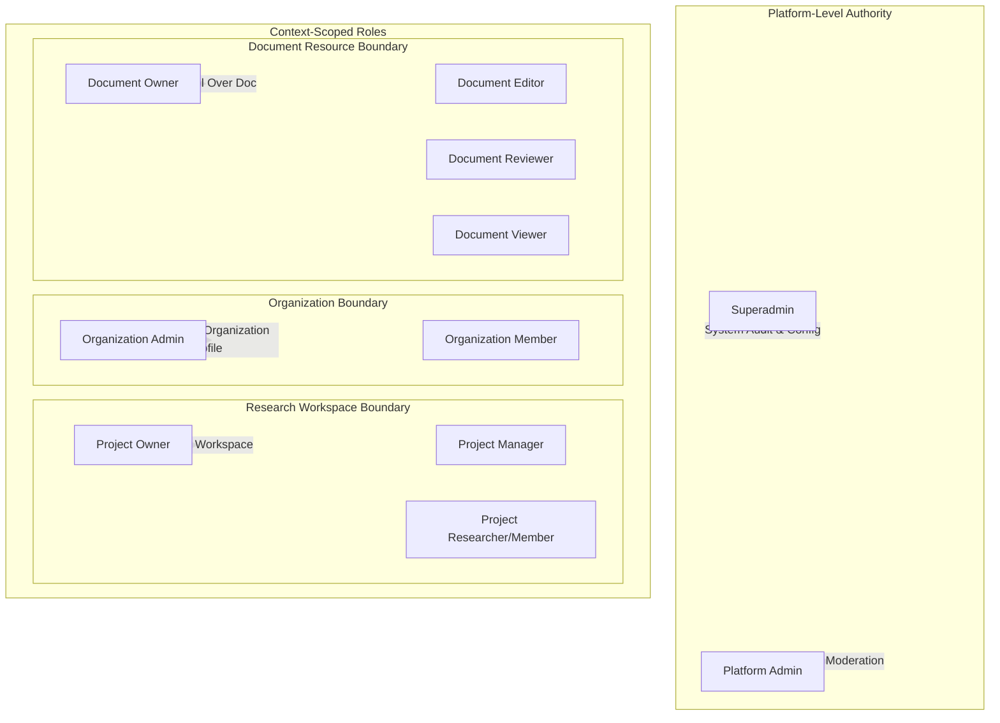

# Pavena — Role-Based Access Control (RBAC) & Permission Matrix

**Document Version:** 1.0  
**Phase:** Phase 1 Foundation Engineering  

---

## 1. Global Platform Administration vs. Contextual Roles

> [!IMPORTANT]
> Platform administration roles (`Superadmin`, `PlatformAdmin`) govern platform safety, compliance, and user moderation. They **never** grant implicit read or write access to private research workspaces or confidential documents.

---

## 2. Multi-Context Permission Matrix

| Operation / Capability | Superadmin | Platform Admin | Org Admin | Project Owner | Document Owner | Document Editor | Standard User |
|---|:---:|:---:|:---:|:---:|:---:|:---:|:---:|
| **Manage Platform Settings** | Yes | No | No | No | No | No | No |
| **Manage Platform Administrators**| Yes | No | No | No | No | No | No |
| **View Platform Audit Logs** | Yes | Yes | No | No | No | No | No |
| **Moderate Users & Content** | Yes | Yes | No | No | No | No | No |
| **Verify Organizations** | Yes | Yes | No | No | No | No | No |
| **Edit Organization Profile** | No* | No* | Yes | No | No | No | No |
| **Approve Org Affiliations** | No* | No* | Yes | No | No | No | No |
| **Manage Research Project** | No* | No* | No | Yes | No | No | No |
| **Invite Project Members** | No* | No* | No | Yes | No | No | No |
| **Edit Document Content** | No* | No* | No | No | Yes | Yes | No |
| **Grant Document Collaborators**| No* | No* | No | No | Yes | No | No |
| **Delete / Archive Document** | No* | No* | No | No | Yes | No | No |

*\*Platform admins may perform moderation takedowns or legal freezes with mandatory audit logging, but cannot edit or view private workspaces for personal or unauthorized purposes.*
