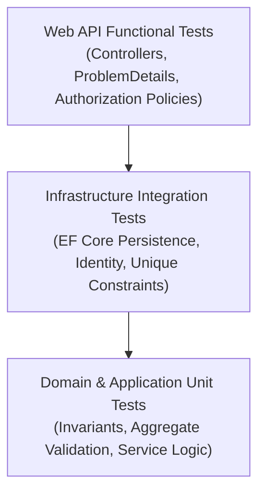

# Pavena — Phase 1 Test Strategy

**Document Version:** 1.0  
**Phase:** Phase 1 Foundation Engineering  

---

## 1. Testing Pyramid & Categorization

### 1. Domain Unit Tests (`Pavena.UnitTests`)
- **Focus:** Pure C# business invariants, aggregate state transitions, validation rules.
- **Scenarios:**
  - `User`: Email and username validation, profile creation.
  - `Connection`: Rejection of self-connections, canonical pair key calculation.
  - `ResearchProject`: Enforcement of single owner invariant (`OwnerUserId` XOR `OwnerOrganizationId`).
  - `Document`: Immutable editor mode, single owner requirement.
  - `OrganizationMembership`: Active state transitions and role scoping.

### 2. Infrastructure & Persistence Integration Tests (`Pavena.IntegrationTests`)
- **Focus:** EF Core mappings, foreign key cascades, unique constraints, and transaction rollback.
- **Scenarios:**
  - Case-insensitive uniqueness of `NormalizedEmail` and `NormalizedUserName`.
  - Canonical connection pair uniqueness.
  - Cascade deletion of `UserProfile` upon `User` removal.
  - `CHECK` constraint enforcement on project single-owner rule.
  - Audit log append-only verification.

### 3. API & Authorization Tests (`Pavena.IntegrationTests`)
- **Focus:** ASP.NET Core Web API test host (`WebApplicationFactory`), auth policies, status codes.
- **Scenarios:**
  - Registration with duplicate email returns `409 Conflict` / validation problem.
  - Authentication with invalid credentials returns `401 Unauthorized`.
  - Admin endpoints return `403 Forbidden` for standard users.
  - Superadmin role allows access to platform admin endpoints.
